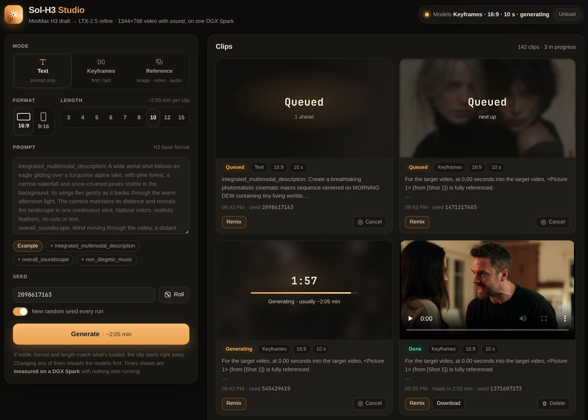

# LF Studio

Unofficial web studio and faster cold start for NVIDIA's Sol-H3 video+audio pipeline: Sol-H3-Spark on one DGX Spark,
or, since 0.5, Sol-H3-RTX5090 on one GeForce RTX 5090 with 64 GB of RAM ([docs/RTX5090.md](docs/RTX5090.md)).
Formerly Sol-H3 Studio, renamed in 0.5 because NVIDIA's own front end for Sol-H3 has that name.



Not affiliated with or endorsed by NVIDIA, MiniMax or Lightricks. Model weights are not included; you download
them yourself under each model's own terms ([Model terms](#model-terms)).

Needs one DGX Spark to itself while it runs (~110 GiB of its memory free), ~300 GB of disk and a Hugging Face account
with access to the gated LTX-2.5 weights. The timed install steps (the ~224 GB download ~48 min, the Stage1 environment
~22 min, the Docker image ~20 min, Stage2 ~6 min, steps 30 and 80 seconds) add up to about 1.6 h; steps 00, 10, 70
and 90 were not timed. Details: [Requirements](#requirements).

## What Sol-H3-Spark is

[Sol-H3-Spark](https://nvlabs.github.io/Sana/Sol-Engine/Sol-H3-Spark/) is NVIDIA Research's two-stage video and
audio pipeline for a single DGX Spark (GB10). It is part of the Sol Video Inference Engine and lives in
[NVlabs/Sana](https://github.com/NVlabs/Sana/tree/sol-engine/models/minimax_h3/Sol-H3-Spark), branch `sol-engine`:

1. A resident NVFP4 Qwen encoder (in a Docker container) encodes the prompt.
2. MiniMax-H3 drafts 672×384×124 frames (FP8, FastH3 4-step LoRA, sparse attention).
3. An H3 ×2 latent upscaler and an H3-to-LTX latent adapter move the draft to LTX-2.5.
4. LTX-2.5 refines it in 3 steps and decodes 1344×768, 121 frames at 24 fps, with H3's audio.

NVIDIA ships it as a command-line tool (`infer.py`) and a Python API, and reports 56 s for a warm 5 s clip.
Modes: text (t2va), first/last frame (fl2va), references (ref2va).

## What this repo adds

**A web studio** (`webui/`, Python standard library only) that keeps the pipeline loaded between clips:

- Modes Text, Keyframes and Reference (images, videos, audio, with H3's numbering), 16:9 or 9:16, 5, 6, 7, 8, 10, 12
  or 15 s.
- Prompt examples and section chips in H3's prompt formats (from MiniMax's
  [prompt-writing guides](https://huggingface.co/MiniMaxAI/MiniMax-H3/tree/main/docs)); seed roll; settings
  remembered per browser.
- A queue. Clips appear as cards with a timer and progress (over the clip's first keyframe, reference image or
  reference video frame, faded, to tell queued clips apart), then a player with Remix, Download and Delete; the
  seed is in the line with the time (a click or Tab selects it, to paste into the Seed box). Remix puts the
  clip's settings, prompt, seed and input files back into the form (with "New random seed every run" ticked, the
  next clip still gets a new seed); the server reuses the files it kept (uploads are stored per clip under
  `$SOL_H3_SPARK_RUNTIME_ROOT/inputs/webui/`). The gallery keeps every clip and loads older ones as you scroll.
  Delete moves a clip and its files to a trash folder for 7 days, with Undo. Cancel takes a queued clip out of the
  queue, or stops a running one (the models then load again for the next clip, about 1-2 min); its card stays as
  Cancelled, with Remix and Delete.
- Another format or length in the same mode keeps the models loaded: the running session changes its shape. Only
  another mode reloads them; the Generate button says when your settings need that, and the clip card shows how
  long the last load took.
  "Load selected now" under it starts loading other settings while you finish the prompt (nothing loads on a
  selection change alone).
- Warm-up at launch with the settings of your last clip; a clip with those settings submitted early in the warm-up
  takes it over, and the Generate button says when it would be ready. Unload button. Dark and light themes, phone layout.
- Uploaded reference videos are normalized (at most 672×384, 24 fps, 2-15 s).

**Writing prompts:** the [prompt guide](docs/API.md#prompt-guide) sums up MiniMax's guides. Start each dialogue line
inside `<d>...</d>` with a capital letter: a lowercase line that opens the clip can add a stray syllable at 0 s. In
the A/B test of [#38](https://github.com/slogonomo/lf-studio/issues/38) (4 seeds per prompt, one DGX Spark), with
the default prompt tokens, a scene that opened with "what" had it in 4 of 4 clips, and none of 4 with "What"
([#53](https://github.com/slogonomo/lf-studio/issues/53)).

**Keyframes clips and the first frame:** the draft starts on your first frame, but in NVIDIA's Sol-H3-Spark route
Stage 2, which refines it to 1344×768, never sees the image: it repaints every frame, the first one too, so faces and
fine detail drift from it ([#57](https://github.com/slogonomo/lf-studio/issues/57)). The studio now holds your first
frame in Stage 2, on the DGX Spark and on the RTX 5090, as NVIDIA's GB200 version of this Stage 2 does. Measured on one
DGX Spark, the clip's first frame matches your image at 30-38 dB PSNR instead of 17-23 dB, with no extra time and
608 MiB more resident memory in Keyframes sessions; on one RTX 5090 at 32-36 dB instead of 18-21 dB, Stage 2 no slower,
no more GPU memory at the peak and 608 MiB more RAM. Later frames are still refined, so clips with a lot of motion can
still drift. `SOL_H3_STAGE2_KEYFRAME=off` turns it off ([details](docs/PATCH.md#19-stage-2-keyframe-pin)).

**An API for agents and scripts** ([docs/API.md](docs/API.md)): the studio's HTTP API, documented, with a JSON
submit and a wait that hands over the MP4 as soon as the clip is done; and `bin/lf-cli`, one Python file for other
machines that is both a command line and an MCP server for agent hosts (Claude Code, Hermes, Codex). It uploads
the input files, waits and saves the MP4 in one step; reading a clip's state never starts a studio that
spark-switchboard has stopped.

**A patch** to Sol-H3-Spark (`patches/lf-studio.patch`, details in [docs/PATCH.md](docs/PATCH.md)). Measured on
one DGX Spark; each "Before" is described in its row:

| | Before | With this patch | Before = |
|---|---|---|---|
| t2va 16:9, 5 s: launch to first finished clip | 282 s | 99 s | NVIDIA's flow plus this patch's persistent compile cache (without it: ~359 s) |
| t2va 16:9, 15 s, first clip | 681 s | 238 s | the pipeline before these changes: NVIDIA's flow with only this patch's length change (NVIDIA supports 5 s only) |
| ref2va with a 5 s reference video, each clip | 400 s | 133 s | the same pipeline with NVIDIA's reference-video canvas (H3's native 768p) instead of this repo's draft canvas |
| Formats | 16:9 | 16:9 and 9:16 | NVIDIA's Sol-H3-Spark |
| Clip length | 5 s | 5-15 s | NVIDIA's Sol-H3-Spark |
| Lip sync in dialogue: SyncNet confidence, man / woman, 8 clips (higher is better) | 4.4 / 3.5 | 7.8 / 5.2 | NVIDIA's Stage 2, which redraws the lips to a copy of the audio that it regenerates and then discards ([details](docs/PATCH.md#15-stage-2-audio-held-fixed-lip-sync)); H3's own draft scores 8.2 / 6.5 (4 of the clips) |

The VAE fix alone, measured with this repo's loading changes already in on both sides: first clip fl2va (first +
last frame, 5 s) 194 → 115 s, ref2va (image + video reference, 5 s) 254 → 178 s. No stock NVIDIA figure was
measured for these two modes.

Where the time went: [docs/PERFORMANCE.md](docs/PERFORMANCE.md). In short: the loading pass renders your clip
instead of a throwaway warm-up, the stages load in parallel, weights are read with O_DIRECT, the first-request
attention self-check covers 8 calls, autotune results persist (and an Inductor autotune-cache bug is worked around),
the VAEs are built on the GPU, and freed CPU memory goes back to the system (on GB10 it is GPU memory too). The
persistent compile cache is also part of the patch, but it is already in the 282 s.

**Install scripts** (`install/00-90`) that build the three environments, the Docker image, the path manifests and
the prompt cache with pinned versions, including fixes found on a DGX Spark (torchaudio on cu132, nvvm/crt pins
for ltx-kernels, a torchaudio stub for the Qwen image). **A launcher** (`bin/lf-studio`) with memory checks
and clean shutdown for a terminal, NVIDIA Sync, systemd or
[spark-switchboard](https://github.com/slogonomo/spark-switchboard). **Bench scripts** (`bench/`): whole-session
timings, and a Stage-2 replay bench with bit-exact and picture checks
([docs/PERFORMANCE.md](docs/PERFORMANCE.md#replay-bench-stage-2-on-saved-drafts)).
**Tests** (`tests/`): the server and the API clients end to end against a GPU-free stub of the pipeline, and the
page in a browser; see [AGENTS.md](AGENTS.md).

## Models

Every clip is made with **Sol-H3**, NVIDIA's two-stage pipeline above, unless you pick another model. Off by default
and on the DGX Spark only, `LFSTUDIO_MODELS=sol-h3,lightx2v-turbo` and the optional install step
`install/66-h3turbo.sh` add an experimental second model, **LightX2V Turbo**: the full MiniMax-H3 in one stage with
LightX2V's [turbo LoRA](https://huggingface.co/lightx2v/Minimax-h3-Turbo), 4 steps. It keeps its keyframes: in a
research probe on one DGX Spark (11 Keyframes clips of 5 s), frame 0 matched the first frame at 30-36 dB PSNR
(compared at 384p), and in the job's own runs a clip with a last frame ended on it (30.9-34.3 dB). Sol-H3 has held the
first frame since 0.5.2 (30-38 dB, measured on other clips), but not a last one. Sol-H3's clips of the probe's
prompts and frames, made before 0.5.2, were at 18-23 dB. The page then gets a Model row at the top of the prompt card,
and agents and scripts name the model (`lf-cli generate --model lightx2v-turbo`, the MCP tool `generate`); `lf-cli
models` and the MCP tool `models` list what each model makes.

- **What it makes:** Text and Keyframes (a first frame, a last frame alone, or both), 5, 6, 7, 8, 10, 12 or 15 s,
  16:9 or 9:16, at 576p (1024×576, the default) or 768p (1344×768). Reference shows greyed out, with the reason. What
  each model makes is a table in the studio, so offering more is a change of that table once a GPU run has validated
  it. A clip with a last frame ends on it: it keeps every frame the model makes (124 at 5 s, 5.17 s, where other clips
  keep the studio's 121), because the model anchors the last frame to its last one. 15 s makes 362 frames, a little
  over the 15.0 s that Diffusers takes; the job lifts that limit for those clips only.
- **It is slower.** Measured on one DGX Spark (its job run by hand, one clip per process, 4 steps): the job took
  2.9-3.2 min for a 5 s clip at 576p and 5.5-5.8 min at 768p, 6.4 and 13.5 min for 10 s, and 10.1 min for 14 s at
  576p; in one Text run each on 2026-10-29, 10.5 min for 15 s at 576p, and 17.3 and 23.8 min for 12 and 15 s at 768p.
  The prompt encode adds 9-18 s ([docs/PERFORMANCE.md](docs/PERFORMANCE.md#experimental-lightx2v-turbo)). Through the
  studio's own queue (staging studios on one DGX Spark, 2026-10-29, one clip each), 5 s clips took 3.1-3.4 min at
  576p and 5.6 min at 768p (6 min with first and last keyframes), and a 10 s clip at 576p 6.7 min, prompt encode
  included; on 2026-10-31 a 15 s Keyframes clip at 576p with both keyframes took 11.3 min. The studio shows an estimate
  per size and length until it has measured a clip of its own (about 3:20 at 576p and 5:50 at 768p for 5 s, 11:00 and
  24:00 for 15 s). A clip closes the Sol-H3 models first when they are loaded (7 s in two staging runs, up to 40 s when
  a worker doesn't answer), and the next Sol-H3 clip loads them again. A 768p clip of 12 s or more needs more free
  memory to start (103 GiB at 12 s, 107 at 15 s, against 100). 6, 7 and 8 s, 12 s at 576p, Keyframes clips longer than
  10 s at 768p (only Text ran at those lengths) and 15 s ones at 576p with one keyframe have not run on the GPU: their
  times and memory floors are estimates from the runs above.
- **Not yet:** keeping its model loaded between clips, and Reference. Its clips of every length can be upscaled
  ([Upscale](#experimental-upscale)).

With the setting off the studio is as it was. Setup:
[docs/INSTALL.md](docs/INSTALL.md#experimental-lightx2v-turbo); the API:
[docs/API.md](docs/API.md#models-experimental-lightx2v-turbo); problems:
[docs/TROUBLESHOOTING.md](docs/TROUBLESHOOTING.md#lightx2v-turbo-experimental).

## Experimental: Upscale

Off by default, DGX Spark only. With `LFSTUDIO_UPSCALE=1` and the optional install step `install/65-regen2k.sh`, a
finished clip's card gets an **Upscale** button. NVIDIA's
[Open-H3-Regenerate-2K](https://github.com/NVlabs/Sana/tree/sol-engine/models/Open-H3-Regenerate-2K) re-renders the
clip with MiniMax-H3 at 1080p, 2K (2560×1440, or 1440×2560 for a 9:16 clip) or 4K, and the result comes as a card of
its own, with the clip's own sound. Agents and scripts have it too: `POST /api/upscale`, `lf-cli upscale` and the MCP
tool `upscale` ([docs/API.md](docs/API.md#upscale-experimental-post-apiupscale)).

- **Every finished clip, 16:9 or 9:16, of every mode, model and length**: Sol-H3's Text, Keyframes and Reference
  clips and LightX2V Turbo's Text and Keyframes clips, 5 to 15 s, whole, in one pass of NVIDIA's refine. The sizes
  depend on the length:

  | Length | 1080p | 2K | 4K |
  |---|---|---|---|
  | 5 s | yes | yes | yes |
  | 6, 7, 8 and 10 s | yes | yes | later |
  | 12 and 15 s | yes | yes | later |

  The popover greys out 4K for longer clips, with the reason (`4K for 12 s clips comes later: 1080p and 2K take
  them`): there the whole clip would not fit in memory, or only past anything measured, so it needs the clip in
  pieces, which comes later. 2K at 12 and 15 s have more tokens than any other size and length (314,380 and 386,606,
  against 302,534 at 4K for 5 s), so the job runs a leaner block forward for them, `lean2` (the transformer's fp32
  video embeddings cast to bf16 and freed once used: on the CPU the same result as the lean forward, bit for bit).
  **2K at 15 s has run**: through the studio on one DGX Spark (2026-10-31) a 15 s 9:16 Sol-H3 clip took 1 h 45 min,
  with all its frames, its whole sound and its lip sync, 94.1 GiB on the GPU at its peak, the free memory down to
  12.6 GiB from 116.6. It needs 113 GiB free to start (114 with Keep my frames holding both ends); 2K at 12 s, which
  that run covers, needs the usual 110 GiB.
  Sol-H3's 3 and 4 s clips (made up to 0.5.0) are refused, never cut: their button is disabled, with the reason.
  NVIDIA's pipeline is written for 5 s: the job takes other lengths through it with their own frames and sound (no
  NVIDIA file changed), and NVIDIA has not validated them. The job refines against text alone: a Keyframes or Reference
  clip's prompt is encoded first without its pictures (its keyframe line, or its references, taken out; ~15 s more). A
  LightX2V Turbo clip at 576p is stretched to 768p first. One with a last keyframe keeps every frame its model made (124
  at 5 s, 243 at 10 s), so the upscale ends on the frame anchored to your last keyframe and has the clip's whole sound;
  a 5 s one at 4K is cut to its first 121 frames until a 124-frame 4K run
  ([#85](https://github.com/slogonomo/lf-studio/issues/85)).
  Through the studio on one DGX Spark (2026-10-29, one clip of each kind), a Sol-H3 Keyframes clip (9:16), a Sol-H3
  Reference clip, a LightX2V Turbo 576p Text clip and a 768p one with first and last keyframes (then cut to 121 frames)
  each took 9.2-9.4 min to 1080p, the encode included, as a Text clip does (9.6 min); the Keyframes clip took 18.6 min
  to 2K. Later that night LightX2V Turbo Keyframes clips with a last keyframe, kept whole (768p 16:9 and 9:16, 576p
  stretched), took 9.3 min to 1080p with all 124 frames and the clip's whole sound, and the 768p 16:9 one 18.6 min to
  2K, and a 576p clip with a first frame (121 frames) took 9.3 min to 1080p. LightX2V Turbo's 768p Text clips have not
  been upscaled through the studio yet: the popover says so, and their times are a Text clip's. Nor have its 576p clips
  at 2K without Keep my frames (with it, three went to 2K on 2026-10-31: below) or its 768p Keyframes clips with a
  first frame alone; the popover counts them with those that have (the 576p clips at 1080p, the 768p ones with both
  keyframes) and gives no note
  ([docs/PERFORMANCE.md](docs/PERFORMANCE.md#experimental-upscale-open-h3-regenerate-2k)). NVIDIA's
  code is written for 16:9: the studio takes a 9:16 clip through it with the shapes turned (no NVIDIA file changed). It
  has as many tokens as 16:9 and took the same time at 1080p and 2K; **9:16 has not run at 4K yet**, and NVIDIA trained
  its refiner on 16:9 video.
- **It is slow.** On one DGX Spark a 2-step upscale of a 5 s clip takes about 10 min at 1080p, 19 min at 2K and 1.1 h
  at 4K (26 min at 2K with 3 steps): ~2 min reading the clip, the refine (2.5 min per step at 1080p, 6.3 min at 2K,
  28 min at 4K: there most of the time), the decode (2-3 min, 6.6 min at 4K) and the load. The models load in ~22 s with
  LF Studio's O_DIRECT loader (`LFSTUDIO_UPSCALE_LOAD=fast`, the default; measured in the studio's job; at 2K the same
  video as NVIDIA's loading, bit for bit), or in ~7.5 min with NVIDIA's own loading (`LFSTUDIO_UPSCALE_LOAD=standard`,
  the fallback; 455 s in the job's 2K run). **4K is the slowest by far** and needs the most memory: the studio's job
  has run it end to end once, a 16:9 clip in 66 min (94.5 GiB on the GPU at its peak); a 9:16 clip has not been
  upscaled to 4K yet. While an upscale runs the studio's models are closed; the next clip loads them again, and with
  `LFSTUDIO_PRELOAD=1` (the default) the studio warms them up again as soon as the upscale is done.
  Numbers: [docs/PERFORMANCE.md](docs/PERFORMANCE.md#experimental-upscale-open-h3-regenerate-2k).
- **Longer clips have run too.** Through the studio on one DGX Spark (2026-10-30, one clip each, 2 steps, the fast load)
  a 6 s clip took 12.7 min to 1080p, a 10 s clip 23.7 min, a 15 s 9:16 clip 43.1 min, and the 10 s clip 53.1 min to 2K,
  each with all its frames and its whole sound, a clean last second and its lip sync; the 10 and 15 s ones at 1080p, by
  eye, sharper than the clip to the last frame, with the same faces. On 2026-10-31 the 15 s clip took 1 h 45 min to 2K,
  with the same checks passed. The other lengths offered (7, 8 and 12 s at 1080p; 6, 7, 8 and 12 s at 2K) have not run,
  but a longer clip at their size has, and the job's model of the runs held there (steps within 1.4 %, peak memory
  within 0.12 GiB): their times follow it, and the popover gives no note. With 2 steps the popover expects, closing the
  studio's models included: at 1080p about 13 min for 6 s, 15 min for 7 s, 17 min for 8 s, 24 min for 10 s, 32 min for
  12 s and 44 min for 15 s; at 2K about 28 min for 6 s, 32 min for 7 s, 37 min for 8 s, 54 min for 10 s, 1.2 h for 12 s
  (an estimate from the model) and 1.8 h for 15 s (its run took 1 h 45 min)
  ([docs/PERFORMANCE.md](docs/PERFORMANCE.md#longer-clips)). From 10 s at 1080p and 6 s at 2K the job runs the
  memory-lean block forward of its 4K run (bit-identical to the stock forward on GB10), so up to 10 s no peak passes
  what the 5 s 2K runs took (91.1 GiB allocated, 92.3 with both ends kept; 90.8 measured at 2K for 10 s); at 2K for 12
  and 15 s `lean2` keeps it at about 89 GiB by the model and 94.1 measured at 15 s. Every length up to 12 s needs the
  110 GiB free a 5 s clip needs to start; at 2K the free memory came down to 16.7 GiB for 10 s and 12.6 GiB for 15 s.
- **Keep my frames** (experimental). NVIDIA's refine redraws a Keyframes clip's first and last frames like any other,
  away from your pictures. With the popover's box (on by default; the request's `pin` `auto`), the job holds your
  keyframes in the refine as MiniMax-H3 holds a keyframe, where the clip already shows them: each end only if the clip's
  own frame matches your picture at 28 dB or more (luma PSNR at 384p: 672×384, or 384×672 for 9:16), and only while the
  picture on disk is the one the clip was made from. An end that does not pass is refined as without the box. With the
  box off (`pin` `off`) the refine is NVIDIA's as it is.
  - LightX2V Turbo's Keyframes clips offer their first frame, their last frame or both, as they have them.
  - Sol-H3's offer their first frame when Stage 2 held it (clips made since 0.5.2 with the default
    `SOL_H3_STAGE2_KEYFRAME=pin`), and never their last: the clip stops a few frames before it (3 at 5 s).
  - Text and Reference clips have no frame to keep.
  - Balanced at 1080p and 2K only for now (Faithful brought a first frame only about 1 dB closer in a test).
  - At 2K the clip is made at 1080p first, then brought to 2K: the 1080p refine with your pictures held, exactly as a
    1080p upscale with the box runs it, then NVIDIA's latent upscaler to the 2K grid and one short refine step there
    (from start noise 0.4) with your pictures held again. A refine at 2K holds the pictures much less than one at
    1080p, and the 2K step only adds detail. In research runs on one DGX Spark (2026-10-29: two LightX2V Turbo clips,
    9:16 and 16:9, 5 s, a first frame; a research runner, its 2K step started from a saved 1080p result) frame 0 came
    2.0-2.1 dB closer to the picture than the plain 2K (the face 3.4-4.8 dB), with 2.2-2.5 times its fine detail, no
    flash and the motion kept; in the same research one pinned refine at 2K had brought it only about 1 dB closer
    (through the studio, both ends of a clip without a face came 4.7-5.0 dB closer that way). Through the studio
    (2026-10-31, LightX2V Turbo Keyframes clips) it has run with a first frame at 5 s in 18 min, and with both ends of
    a 10 s clip in 50 min and of a 15 s clip in 1 h 35 min: every end held, with no flash, and the lip sync kept where
    the clip speaks. **It holds your pictures a little less closely than 1080p does**: each end came out about 1.5-2 dB
    further from its picture (luma PSNR at the job's 384p check grid), as the 2K step adds fine detail and a little
    contrast over the whole clip. It holds them closer than 2K without the box: at 5 s frame 0 came 2 dB closer to the
    picture than the plain 2K and about 1 dB closer than one pinned refine at 2K, the route it replaced (at the output
    size; 1.5 dB at the check grid). If matching your pictures matters most, use 1080p. The popover has no note for a
    LightX2V Turbo clip's first frame alone at 5 s. For both ends at 10 and 15 s it keeps its note that keeping your
    frames has not run there until the maintainer has looked at those runs: they held every end about as closely as the
    5 s run, but the bar set for them, within 1 dB of 1080p, is one that neither they nor the 5 s run meet. The other
    routes at 2K (both ends at 5 s and at the other lengths, a first frame alone past 5 s, a last frame alone, a Sol-H3
    clip's first frame) have not run, and the note says so. Its time is the job's model, which those runs came within a
    minute of: about 19 min at 5 s (as without the box), 49-50 min at 10 s, 67-68 min at 12 s and 94-95 min at 15 s
    (against 74 and 106 min without the box). Its 2K step at 12 and 15 s runs `lean2`, as 2K without the box does there,
    and needs 113 GiB free at 15 s with one end, 114 with both (its 2K step's pictures add rows); the 15 s run came down
    to 11.8 GiB free from 116.8.
  - On clips longer than 5 s it is offered at the sizes their length has. It has run with both ends of a LightX2V
    Turbo 10 s clip at 1080p (2026-10-30), with the lean block forward: both ends held, 31.9 and 32.0 dB from your
    pictures (luma PSNR at 1080p), as close as the best 5 s pinned run, with no flash at either end; and at 2K
    through the cascade (above). The other long routes and sizes have not run: the popover says so. The time it adds
    on a long clip is the 5 s one, so a little short: both ends at 1080p for 10 s add about 45 s (an estimate from
    that run, which had no unpinned twin) where the progress bar counts 32 s. At 2K the time is the cascade's own, its
    rows counted at each length (above).
  - The popover says why an end is not offered; the upscale's card says which ends were kept, and why not.
  - It has run through the studio on one DGX Spark (the night of 2026-10-29 to 30) with a LightX2V Turbo clip's first
    frame, last frame and both at 1080p, both at 2K too (then in one pinned refine at 2K, the route the cascade above
    replaces), and a Sol-H3 clip's first frame at 1080p. Against the same
    clips upscaled without it, the frame held came 3.2-5.3 dB closer to your picture (luma PSNR; 2.5-5.5 dB on a face;
    at 2K +5.0 and +4.7 dB, a clip without a face), with no flash there. A dialogue clip gained less, 2.3-2.4 dB at each
    end (3 dB on the face), as its plain upscale was already close to the picture; its lip sync held. It costs about
    16 s per end at 1080p (32 s for both) and 0.4-0.7 GiB more GPU memory at the peak. The one pinned refine at 2K took
    1.3 GiB more, and the lowest free memory came down to 14.1 GiB with both ends (16.0 GiB without); the cascade
    with one end at 5 s took 91.7 GiB at its peak (its 2K step), as one pinned refine at 2K did with one end in the
    research runs, and came down to 17.2 GiB free.
- **At full strength it changes faces.** NVIDIA's setting ("Full re-generate": start noise 0.909, 3 steps) gives a
  much sharper picture but redraws faces into a different-looking person.
  "Balanced" (0.7, 2 steps, the default) and "Faithful" (0.5, 2 steps) redraw less; how they look, and whether the
  clip's own audio (the default) or NVIDIA's silence works better for lip sync, is still being measured. The
  defaults are provisional (`LFSTUDIO_UPSCALE_STRENGTH`, `LFSTUDIO_UPSCALE_AUDIO`).

Not yet: 4K for clips longer than 5 s (the clip in pieces), and NVIDIA's faster Sol-Attn forward. Setup:
[docs/INSTALL.md](docs/INSTALL.md#experimental-upscale); problems:
[docs/TROUBLESHOOTING.md](docs/TROUBLESHOOTING.md#upscale-experimental).

## Deviations from NVIDIA's validated recipe

NVIDIA validated the 5 s, 16:9 route. Portrait output is not quality-validated (the LoRAs, upscaler and adapter
were trained on landscape). Lengths other than 5 s are not validated by NVIDIA. The studio offers 5-15 s, inside the
4-15 s that MiniMax lists for H3; 3 and 4 s, offered up to 0.5.0, are gone (3 s clips never came out right), and the
patch still takes them, for `infer.py` and the bench. The first-request attention self-check covers 8 calls instead of
200. Portrait and length are derived after the frozen-recipe hash check. Stage 2 refines the video against the H3 audio
held fixed instead of a re-noised copy that it regenerates and then discards (NVIDIA's contract), for better lip sync.
Since 0.4 the prompt encoder reads the dialogue tags `<d>` and `</d>` as single tokens, as MiniMax's tokenizer does and
H3 was trained with (`SOL_H3_PROMPT_TOKENS=minimax`; `plain` tokenizes as before). Also since 0.4, Stage 1 and Stage 2
compile with static shapes (`SOL_H3_STATIC_SHAPES=0` compiles as upstream does), Stage 1's body blocks compile once per
session for any prompt length (`SOL_H3_DYNAMIC_TEXT_LENGTH=0` compiles them per length, as upstream does), and a session
changes its length and orientation in place, one worker rendering several shapes (`LFSTUDIO_RESHAPE=0` loads the models
again). Since 0.5.2, on the DGX Spark and on the RTX 5090, Stage 2 holds a Keyframes clip's first frame at latent
frame 0, encoded from your image; in NVIDIA's Sol-H3-Spark route Stage 2 never sees the image
(`SOL_H3_STAGE2_KEYFRAME=off` runs that route).
All of it can be switched back; see [docs/PATCH.md](docs/PATCH.md#deviations-from-nvidias-validated-recipe).

## Requirements

- One NVIDIA DGX Spark (GB10, 128 GB). The pipeline needs nearly all memory: ~110 GiB free to start.
- DGX OS (Ubuntu 24.04 aarch64), CUDA 13 at `/usr/local/cuda`, Python 3.12 with venv, git, curl, ffmpeg, Docker
  with the NVIDIA runtime. Tested with driver 580.178.04.
- ~300 GB free disk (weights ~224 GB); ~60 GB if you reuse weights you already have (`LFSTUDIO_CHECKPOINTS`).
- A Hugging Face account that accepted the [Lightricks/LTX-2.5](https://huggingface.co/Lightricks/LTX-2.5) terms,
  and a read token for it (the quick start logs in with it).

## Quick start

```bash
git clone https://github.com/slogonomo/lf-studio ~/src/lf-studio && cd ~/src/lf-studio
# Hugging Face login, once (accept the LTX-2.5 terms in the browser first). This is the download tool that
# install/20-weights.sh uses; the paths assume the default LFSTUDIO_HOME=~/sol-h3.
python3.12 -m venv ~/sol-h3/envs/download && ~/sol-h3/envs/download/bin/pip install huggingface-hub==1.29.0
~/sol-h3/envs/download/bin/hf auth login     # or: export HF_TOKEN=<your read token>
install/00-check.sh            # prerequisites; changes nothing
install/10-sana.sh             # NVlabs/Sana sol-engine + this patch
install/20-weights.sh          # ~224 GB, ~48 min at ~80 MB/s
install/30-sources.sh
install/40-stage1.sh           # ~22 min
install/50-stage2.sh           # ~6 min
install/60-qwen-image.sh       # ~20 min
install/70-manifests.sh
install/80-prompt-cache.sh     # uses the GPU for ~20 s
install/90-env.sh              # writes ~/.config/lf-studio/env
bin/lf-studio                  # then open http://localhost:8190
```

Every install script takes `--dry-run`. Paths, ports and switches: [bin/env.example](bin/env.example). Details,
times, disk use, which scripts have been run end to end, and updating: [docs/INSTALL.md](docs/INSTALL.md).
Problems: [docs/TROUBLESHOOTING.md](docs/TROUBLESHOOTING.md).

**RTX 5090.** The same studio (page, queue, agent API, CLI) also runs on a workstation with one GeForce RTX 5090
and 64 GB of RAM, x86_64, with NVIDIA's Sol-H3-RTX5090 package (CPU offload) and its own patch, which makes it fit
64 GB without changing what the models compute. `LFSTUDIO_BACKEND=rtx5090` selects it. Its install has its own steps
and order (no Docker; Python from uv; step 05 first, 80 before 70): follow
[docs/INSTALL.md](docs/INSTALL.md#rtx-5090), not the list above. It needs a DGX Spark's prompt cache
(`fixed-prompt.pt`), and the weights can be copied from a Spark too. Measured there, next to a desktop: a 5 s text clip in 27 s, 15 s in 66 s, a
reference clip in 50 s; launch to the first clip 57 s once the models' snapshots exist. Without the setting
everything is the DGX Spark's, as above. Details and measurements: [docs/RTX5090.md](docs/RTX5090.md); steps:
[docs/INSTALL.md](docs/INSTALL.md#rtx-5090).

To update: `git pull`, then `install/10-sana.sh`, then restart the studio ([details](docs/INSTALL.md#updating)).
0.6 no longer reads the names the studio had up to 0.4, which 0.5 still did
([From 0.5 to 0.6](docs/INSTALL.md#from-05-to-06)): an install that still uses the settings `SOLH3_*` or the folder
`~/.config/sol-h3-studio` stops before it starts and names each with its new name. `bin/sol-h3-studio` and
`bin/sol-h3` are gone, so whatever still runs them fails with "No such file or directory"; run `bin/lf-studio` and
`bin/lf-cli` instead.
0.4 changes the patch: until `install/10-sana.sh` has applied it, the studio refuses to start with
"SOL_H3_PROMPT_TOKENS=minimax (the default since 0.4) needs a newer patch than the one applied in ...".
0.4 also answers only to known host names: if you open the studio by a name other than an IP address, `localhost`, a
name without a dot or one ending in `.ts.net`, `.local`, `.lan`, `.home`, `.home.arpa` or `.internal`, add it to
`LFSTUDIO_ALLOWED_HOSTS` before you restart, or every request gets 421 ([more](docs/INSTALL.md#updating)).

The server listens on 127.0.0.1:8190. From a laptop use [NVIDIA Sync](docs/nvidia-sync.md) or
`ssh -L 8190:127.0.0.1:8190 you@spark-xxxx.local`. `LFSTUDIO_HOST=0.0.0.0` serves the LAN; there is no login, so only
on a network you trust (cross-site form posts, and host names the studio doesn't know, are refused; see
[docs/API.md](docs/API.md#access)). Scripts and agents use the same port: [docs/API.md](docs/API.md).

## Model terms

This repo contains no model weights and no H3-generated media. `install/20-weights.sh` runs NVIDIA's
`download_checkpoints.py`, which fetches pinned revisions from Hugging Face with your account. Each model has its
own license; read it before you download or use the model or its outputs:

| Model | Used for | Terms |
|---|---|---|
| [MiniMaxAI/MiniMax-H3](https://huggingface.co/MiniMaxAI/MiniMax-H3) | draft model | [MiniMax H3 Community License Agreement](https://huggingface.co/MiniMaxAI/MiniMax-H3/blob/main/LICENSE). It does not cover the EU, the UK, South Korea or the USA (its §I.5 and §V.4); MiniMax links an [application form](https://platform.minimax.io/h3-license) for a license there. |
| [FastVideo/FastVideo-FastH3-4-step-Preview-v1-LoRA](https://huggingface.co/FastVideo/FastVideo-FastH3-4-step-Preview-v1-LoRA) | 4-step draft LoRA (t2va, fl2va) | see the model card; NVIDIA's notices list it under the MiniMax-H3 license |
| [lightx2v/Minimax-h3-Turbo](https://huggingface.co/lightx2v/Minimax-h3-Turbo) | 4-step draft LoRA (ref2va); the experimental LightX2V Turbo's fl2v 4-step v1.3 and 8-step v1.1 768p LoRAs (`install/66-h3turbo.sh`) | the card declares Apache-2.0; the MiniMax-H3 base model keeps its own terms |
| [Comfy-Org/MiniMax-H3](https://huggingface.co/Comfy-Org/MiniMax-H3) | NVFP4 prompt encoder file | see the model card; NVIDIA's notices list it under the MiniMax-H3 license |
| [Lightricks/LTX-2.5](https://huggingface.co/Lightricks/LTX-2.5) | refiner, LoRA, VAEs, offline prompt-cache weights | gated; LTX-2.x Community License Agreement |
| [LBH-123-AI/Minimax_h3_latent_Upscaler](https://huggingface.co/LBH-123-AI/Minimax_h3_latent_Upscaler) ([source](https://github.com/LBH-123-AI/Comfyui_Minimax_h3_latent_Upscaler)) | H3 ×2 latent upscaler | weights: the model card states Apache-2.0 (in its text at NVIDIA's pinned revision 13ccf95, and in its metadata since 2026-09-17). Source: MIT since 2026-09-17 (commit 40316cf); NVIDIA's pinned source revision d7c01b9 has no license file. NVIDIA's notices say no license is declared. Not redistributed here or by NVIDIA. |
| [Efficient-Large-Model/H3-to-LTX-Latent-Adapter](https://huggingface.co/Efficient-Large-Model/H3-to-LTX-Latent-Adapter) | H3-to-LTX latent adapter | the model card assigns no separate weight license |
| [Efficient-Large-Model/Open-H3-Regenerate-2K](https://huggingface.co/Efficient-Large-Model/Open-H3-Regenerate-2K) | the experimental Upscale only (`install/65-regen2k.sh`): refiner LoRA, Sharp curve branches, latent upscaler | its card: the refiner LoRA follows the MiniMax H3 Community License, territory, use and redistribution terms included; the parts NVIDIA did not train keep their own licenses: the latent upscaler (the LBH-123-AI one above), and the [LightX2V FL2VA Turbo](https://huggingface.co/lightx2v/Minimax-h3-Turbo) and [LMS Sharp](https://huggingface.co/Alissonerdx/Minimax-H3-ComfyUI) LoRAs merged into its LoRA. "This bundle is not covered by a single blanket license." The Sharp AdaLN table it needs is read from the Comfy-Org/MiniMax-H3 file above. |

Sol-H3-Spark's own [THIRD_PARTY_NOTICES.md](https://github.com/NVlabs/Sana/blob/sol-engine/models/minimax_h3/Sol-H3-Spark/THIRD_PARTY_NOTICES.md)
lists the pinned revisions and terms.

## Credits

- **Sol-H3-Spark** and the Sol Video Inference Engine: NVIDIA Research
  ([project page](https://nvlabs.github.io/Sana/Sol-Engine/Sol-H3-Spark/),
  [code](https://github.com/NVlabs/Sana/tree/sol-engine/models/minimax_h3/Sol-H3-Spark)). The two-stage method,
  the runtime and the install flow this repo builds on are theirs.
- Built on MiniMax-H3, FastVideo/FastH3 (Hao AI Lab), LTX-2.5 (Lightricks), Sol-Attn, ComfyUI, LightX2V, the
  LBH-123-AI H3 latent upscaler and the Efficient-Large-Model H3-to-LTX adapter.
- The experimental LightX2V Turbo model runs **LightX2V's turbo LoRA for MiniMax-H3**
  ([lightx2v/Minimax-h3-Turbo](https://huggingface.co/lightx2v/Minimax-h3-Turbo),
  [code](https://github.com/ModelTC/Minimax-H3-Turbo), by ModelTC's LightX2V team) on the full MiniMax-H3, with the
  modular MiniMax-H3 pipeline of Diffusers (Hugging Face).
- The experimental Upscale runs **Open-H3-Regenerate-2K** by NVIDIA Research
  ([project page](https://nvlabs.github.io/Sana/Open-H3-Regenerate-2K/),
  [code](https://github.com/NVlabs/Sana/tree/sol-engine/models/Open-H3-Regenerate-2K)), with the SoL-Refiner
  refinement recipe. Its LoRA merges LightX2V's FL2VA Turbo adapter and Alissonerdx's LMS Sharp LoRA. NVIDIA asks
  users to cite the SoL-Refiner paper together with the project page (the last two citations below).

### Citations

- Yitong Li, Junsong Chen, Haopeng Li, Haozhe Liu, Jincheng Yu, Ligeng Zhu, Ping Luo, Song Han, Enze Xie.
  *Sol Video Inference Engine: Agent-Native Full-Stack Acceleration Framework for Efficient Video Generation.*
  2026. [arXiv:2606.23743](https://arxiv.org/abs/2606.23743)
- Haopeng Li, Yitong Li, Junsong Chen, Tian Ye, Haozhe Liu, Jincheng Yu, Duomin Wang, Ruihua Zhang, Zeke Xie,
  Enze Xie, Song Han. *Sol-Attn: Accelerating Video Generation Inference via On-the-Fly Attention Sparsification.*
  2026. [arXiv:2607.24027](https://arxiv.org/abs/2607.24027)
- Haozhe Liu, Tian Ye, Shuchen Xue, Yitong Li, Junsong Chen, Haopeng Li, Jincheng Yu, Duomin Wang, Ruihua Zhang,
  Lei Zhu, Song Han, Enze Xie. *SoL-Refiner: Speed-of-Light One-Step Refinement for High-Resolution Video.* 2026.
  [arXiv:2609.37969](https://arxiv.org/abs/2609.37969)
- Sensen Gao, Haozhe Liu, Yitong Li, Haopeng Li, Tian Ye, Jia-Wang Bian, Song Han, Enze Xie.
  *Open-H3-Regenerate-2K: High-Resolution Video Refinement with Few-Step Diffusion.* Project page, 2026.
  [nvlabs.github.io/Sana/Open-H3-Regenerate-2K](https://nvlabs.github.io/Sana/Open-H3-Regenerate-2K/)

<details>
<summary>BibTeX</summary>

```bibtex
@misc{li2026solvideoinferenceengine,
  title         = {Sol Video Inference Engine: Agent-Native Full-Stack Acceleration Framework for Efficient
                   Video Generation},
  author        = {Yitong Li and Junsong Chen and Haopeng Li and Haozhe Liu and Jincheng Yu and
                   Ligeng Zhu and Ping Luo and Song Han and Enze Xie},
  year          = {2026},
  eprint        = {2606.23743},
  archivePrefix = {arXiv},
  primaryClass  = {cs.CV},
  doi           = {10.48550/arXiv.2606.23743},
  url           = {https://arxiv.org/abs/2606.23743},
}

@article{li2026solattn,
  title   = {Sol-Attn: Accelerating Video Generation Inference via On-the-Fly Attention Sparsification},
  author  = {Li, Haopeng and Li, Yitong and Chen, Junsong and Ye, Tian and Liu, Haozhe and Yu, Jincheng and
             Wang, Duomin and Zhang, Ruihua and Xie, Zeke and Xie, Enze and Han, Song},
  journal = {arXiv preprint arXiv:2607.24027},
  year    = {2026}
}

@misc{liu2026solrefiner,
  title         = {{SoL-Refiner}: Speed-of-Light One-Step Refinement for High-Resolution Video},
  author        = {Haozhe Liu and Tian Ye and Shuchen Xue and Yitong Li and
                   Junsong Chen and Haopeng Li and Jincheng Yu and Duomin Wang and
                   Ruihua Zhang and Lei Zhu and Song Han and Enze Xie},
  year          = {2026},
  eprint        = {2609.37969},
  archivePrefix = {arXiv},
  primaryClass  = {cs.CV},
  url           = {https://arxiv.org/abs/2609.37969}
}

@misc{gao2026openh3regenerate2k,
  title        = {Open-H3-Regenerate-2K: High-Resolution Video Refinement with Few-Step Diffusion},
  author       = {Sensen Gao and Haozhe Liu and Yitong Li and Haopeng Li and Tian Ye and Jia-Wang Bian and
                  Song Han and Enze Xie},
  year         = {2026},
  howpublished = {\url{https://nvlabs.github.io/Sana/Open-H3-Regenerate-2K/}},
  note         = {Project page}
}
```

</details>

## Related projects

Other public MiniMax-H3 / Sol-H3 work, on DGX Spark and in ComfyUI, as of 2026-10 (not affiliated with this repo):

- [trahane/dgx-spark-sol-h3-ref2v](https://github.com/trahane/dgx-spark-sol-h3-ref2v): a reproducible wrapper
  for Sol-H3-Spark's ref2va pipeline (CLI).
- [scottzx/dgx-spark-deploy](https://github.com/scottzx/dgx-spark-deploy): a Spark toolkit with scripts that run
  Sol-H3-Spark next to an LLM (CLI).
- [wassermanproductions/wasserman-spark-director-h3-speed-recipe](https://github.com/wassermanproductions/wasserman-spark-director-h3-speed-recipe):
  a two-Spark recipe that starts from Sol-H3-Spark.
- [Xplore-LAB/minimax-h3-dgx-spark](https://github.com/Xplore-LAB/minimax-h3-dgx-spark): a MiniMax-H3 on DGX Spark
  recipe; NVIDIA's `configs/dependencies.json` cites it as the source of its ComfyUI pin.
- ComfyUI nodes: [T8mars/comfyui-minimax-h3-audio-T8](https://github.com/T8mars/comfyui-minimax-h3-audio-T8)
  (H3 draft → LTX-2.5 refine as nodes) and [xmarre/ComfyUI-Sol-H3](https://github.com/xmarre/ComfyUI-Sol-H3)
  (H3 inference acceleration for ComfyUI in general, not specific to DGX Spark).
- [spark-switchboard](https://github.com/slogonomo/spark-switchboard), the companion repo: starts and stops apps
  like this studio on demand on one Spark (`integrations/spark-switchboard/`).

## License

Apache-2.0 ([LICENSE](LICENSE), [NOTICE](NOTICE)).

- The patch modifies Apache-2.0 code from NVlabs/Sana; `runtime/qwen_ops/media.py` also contains FastVideo-derived
  Apache-2.0 code. Each modified file is marked "Modified by lf-studio".
- ComfyUI (GPL-3.0) runs inside the Qwen container that you build yourself with `install/60-qwen-image.sh`, on top
  of NVIDIA's NGC PyTorch image (NVIDIA terms). This repo ships only the Dockerfile layer and three stub files.
  Never redistribute the built image.
- Model weights are not covered by this license; see [Model terms](#model-terms).

NVIDIA, DGX Spark and NVIDIA Sync are trademarks of NVIDIA Corporation; MiniMax and MiniMax H3 are trademarks of
MiniMax; LTX is a trademark of Lightricks. The names are used only to describe what this project works with.
